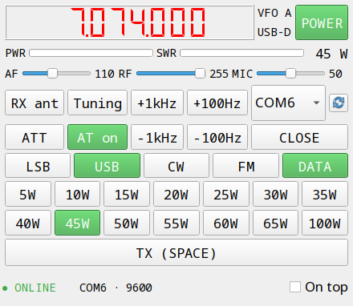

# Kenwood transceiver remote control software
More information - https://ra0sms.com/kenwood-control-software/



A compact replacement for the standard Kenwood ARCP-590 software for the TS-590S / TS-590SG.
It has limited functionality, but works noticeably faster than the original software.
The power buttons make it easy to set the right drive level for a tube power amplifier.

Based on Python 3 and PyQt5. If you want, you can change the source code for your needs.

## Features
- Frequency, VFO and mode display; tuning with buttons or the mouse wheel over the frequency
  (100 Hz step, Ctrl + wheel - 1 kHz)
- Drive power buttons (steps are configurable) and actual TX power display
- ALC and SWR meters during transmit
- RX antenna, attenuator, antenna tuner, power on/off
- PTT: the TX button or hold SPACE. TX is released when the window loses focus,
  the port is closed or the program exits
- Link indicator in the status bar:
  - `● ONLINE` (green, the dot blinks with every answer) - TRX answers
  - `● WAIT` / `● SLOW` (orange) - waiting for the first answer / answers are late
  - `● NO ANSWER` (red) - TRX does not answer
  - `● CTS LOW` (red) - TRX does not accept commands (RTS/CTS handshake), check the cable
- Remembers the last COM port and connects to it at startup
- "On top" mode to keep the window above a logger

## Download
Windows builds are published on the [Releases](https://github.com/ra0sms/TS590_CAT_Control/releases) page.
Download `kenwood_control-<version>-windows.exe` and run it, no installation is needed.

## Settings
On the first start the program creates `kenwood_control.ini` next to the exe:

```ini
[power]
steps=10, 15, 20, 25, 30, 35, 40, 45, 50, 55, 60, 65, 100

[serial]
port=COM6
baud=9600
flow_control=true

[window]
on_top=false
```

- `power/steps` - power buttons in watts (5...100), 7 buttons per row
- `serial/baud` - must match the COM port speed set in the TRX menu
- `serial/flow_control` - RTS/CTS hardware handshake. The TS-590 needs it; set `false`
  only for a cable without RTS/CTS lines

## Running from source
```
pip install -r requirements.txt
python src/kenwood_control.py
```

## Building
The exe is built with PyInstaller. It builds for the OS it runs on, so the Windows version
must be built on Windows:
```
pip install -r requirements.txt pyinstaller
python build.py
```
The result is `dist/kenwood_control-<version>-windows.exe`.

### Release on GitHub
Releases are built automatically by GitHub Actions (`.github/workflows/release.yml`):
1. Change `VERSION` in `src/kenwood_control.py` and commit.
2. Push a tag with the same version:
   ```
   git tag v1.1.0
   git push origin v1.1.0
   ```
3. GitHub builds the Windows exe and creates the release with it.

A test build without a release: Actions -> Release -> Run workflow, the exe is in the run's Artifacts.
